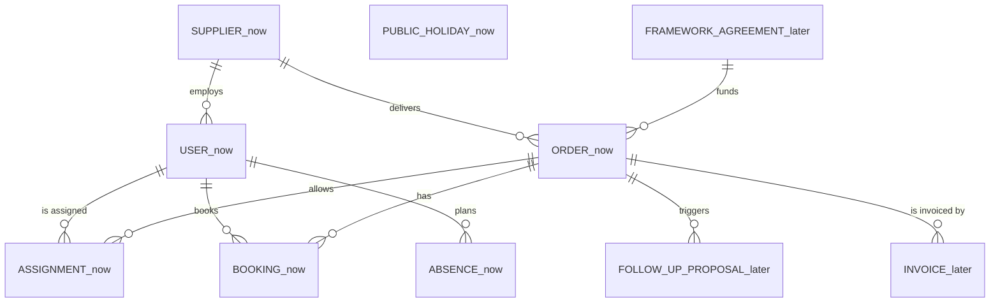

# Domain model

> See [guide 2.3](guide.md#23-model-the-domain).

## Glossary

| Term | Meaning |
|---|---|
| Supplier | External service provider (consulting firm, agency, freelancer) that delivers work and invoices the client. |
| Consultant | Individual person working for a supplier. The client only stores a supplier-side reference and a display name, nothing more. |
| Purchase order (Bestellung, PO) | The client's order to a supplier. It holds the budget, usually in person-days, for a period. |
| Order item | One line of a purchase order, with its own ordered person-days, day rate and period. Bookings are charged to an item. |
| Person-day (Personentag, PD / PT) | Unit of budget. One PD is about 8 hours. |
| Assignment | Which consultant is staffed on which order item, at which day rate and for how long. Decides what a consultant may book on. |
| Accounting object (Kostenstelle / PSP-Element) | Cost centre or project element that the booked effort is charged to internally. |
| Time booking | One entry: a consultant, a day, a duration, a short description, charged to an order item and an accounting object. |
| Absence | Planned vacation or sick leave of a consultant. Reduces capacity in the forecast. |
| Public holiday (Feiertag) | Non-working day. Differs between the 16 German federal states, so the consultant's work location matters. |
| Budget forecast | Snapshot that projects when an order's budget will be exhausted and how many PD are missing until the end of the project. |
| Framework agreement (Rahmenvertrag) | Overall contract with a supplier from which purchase orders can be drawn. |
| Proof of work (Leistungsnachweis) | Monthly statement of the approved bookings of an order. Must be approved before an invoice is paid. |
| Invoice | Supplier invoice that is checked against an approved proof of work. |
| Client user | Employee of the client (project lead, purchasing, finance) who approves work and reads budgets. |
| Rule violation | A booking that breaks or looks suspicious against ArbZG (Working Time Act) rules or plausibility checks. |
| ArbZG | German Working Time Act: daily maximum, breaks, rest periods. |

## Entity relationship diagram

Entities we **build now** are marked `(now)`, entities of the **next expansion stage** `(later)`.

- **Now:** Supplier, Purchase order, Order item, Consultant, Assignment, Accounting object, Time booking, Absence, Public holiday, Budget forecast. These cover the core flow: a consultant books time against an order and the client sees the effect on that order's budget, including the look-ahead with vacations and holidays.
- **Later:** Framework agreement, Invoice, Rule violation. Proof of work and the user roles already exist in a first form, see "Implemented schema" below.

```mermaid
erDiagram
    SUPPLIER["SUPPLIER (now)"] {
        int supplier_id PK
        string name
        string vat_id
        string address
    }
    FRAMEWORK_AGREEMENT["FRAMEWORK_AGREEMENT (later)"] {
        int framework_id PK
        int supplier_id FK
        string agreement_number
        decimal total_pd
        date valid_from
        date valid_until
    }
    PURCHASE_ORDER["PURCHASE_ORDER (now)"] {
        int po_id PK
        int supplier_id FK
        int framework_id FK "nullable, if drawn from framework"
        string po_number
        decimal ordered_pd
        date period_start
        date period_end
        string status
    }
    ORDER_ITEM["ORDER_ITEM (now)"] {
        int item_id PK
        int po_id FK
        string item_number
        decimal ordered_pd
        decimal day_rate
        date period_start
        date period_end
    }
    CONSULTANT["CONSULTANT (now)"] {
        int consultant_id PK
        int supplier_id FK
        string external_ref "supplier-side ID, no client PII beyond this"
        string display_name "PERSONAL DATA"
        string federal_state "work location, drives PublicHoliday lookup"
        bool is_active
    }
    ACCOUNTING_OBJECT["ACCOUNTING_OBJECT (now)"] {
        int accounting_object_id PK
        enum object_type "cost_centre | project_element"
        string code
        string name
        date valid_from
        date valid_until
    }
    ASSIGNMENT["ASSIGNMENT (now)"] {
        int assignment_id PK
        int consultant_id FK
        int item_id FK
        decimal day_rate
        date valid_from
        date valid_until
    }
    TIME_BOOKING["TIME_BOOKING (now)"] {
        int booking_id PK
        int consultant_id FK
        int item_id FK
        int accounting_object_id FK
        date booking_date
        decimal duration_hours
        string description "short work description"
        enum status "draft | submitted | approved | rejected"
        datetime created_at
    }
    ABSENCE["ABSENCE (now)"] {
        int absence_id PK
        int consultant_id FK
        enum absence_type "vacation | sick_leave"
        date start_date
        date end_date
        decimal hours_per_day "planned, for capacity math"
    }
    PUBLIC_HOLIDAY["PUBLIC_HOLIDAY (now)"] {
        int holiday_id PK
        date holiday_date
        enum federal_state "applies only in this state, or ALL"
        string name
    }
    PROOF_OF_WORK["PROOF_OF_WORK (later)"] {
        int proof_id PK
        int po_id FK
        int approved_by_user_id FK "nullable until approved"
        int period_year
        int period_month
        enum status "draft | submitted | approved | rejected"
        datetime submitted_at
        datetime approved_at
    }
    INVOICE["INVOICE (later)"] {
        int invoice_id PK
        int proof_id FK
        int supplier_id FK
        string invoice_number
        decimal net_amount
        decimal vat_amount
        enum status "received | approved | paid"
        date received_date
        date paid_date
    }
    CLIENT_USER["CLIENT_USER (later)"] {
        int user_id PK
        string display_name "PERSONAL DATA"
        string email "PERSONAL DATA"
        enum role "project_lead | purchasing | finance"
        bool is_active
    }
    BUDGET_FORECAST["BUDGET_FORECAST (now)"] {
        int forecast_id PK
        int po_id FK
        date snapshot_date
        date expected_end_date "when ordered PD will be exhausted"
        decimal missing_pd "PD shortfall/surplus vs ordered"
        string calculation_basis "incl. absences and public holidays"
    }
    RULE_VIOLATION["RULE_VIOLATION (later)"] {
        int violation_id PK
        int booking_id FK
        enum rule_type "arbz_daily_max | arbz_break | arbz_rest_period | plausibility"
        enum severity "info | warning | blocking"
        string message
        datetime detected_at
        datetime resolved_at "nullable"
    }
    SUPPLIER ||--o{ FRAMEWORK_AGREEMENT : offers
    SUPPLIER ||--o{ PURCHASE_ORDER : receives
    FRAMEWORK_AGREEMENT |o--o{ PURCHASE_ORDER : "draws budget from (optional)"
    SUPPLIER ||--o{ CONSULTANT : employs
    PURCHASE_ORDER ||--|{ ORDER_ITEM : contains
    CONSULTANT ||--o{ ASSIGNMENT : "assigned via"
    ORDER_ITEM ||--o{ ASSIGNMENT : "staffed via"
    CONSULTANT ||--o{ TIME_BOOKING : books
    ORDER_ITEM ||--o{ TIME_BOOKING : "charged to"
    ACCOUNTING_OBJECT ||--o{ TIME_BOOKING : "billed via"
    CONSULTANT ||--o{ ABSENCE : "reports (vacation/sick)"
    PURCHASE_ORDER ||--o{ PROOF_OF_WORK : "verified per period"
    CLIENT_USER ||--o{ PROOF_OF_WORK : approves
    PROOF_OF_WORK ||--o| INVOICE : "settled by"
    SUPPLIER ||--o{ INVOICE : issues
    PURCHASE_ORDER ||--o{ BUDGET_FORECAST : "projects burn-down"
    TIME_BOOKING ||--o{ RULE_VIOLATION : "may trigger"
```

## Implemented schema (what the migrations create)

The diagram above is the **target model**: what the product grows into. The first stage that runs today is smaller. This is the schema of the migrations in `database/migrations`:

Tables (MySQL):

- `suppliers(id, name)`
- `users(id, name, email, password, role, supplier_id null)` where role is `consultant`, `project_lead`, `purchasing`, `finance` or `admin`
- `orders(id, number, title, supplier_id, cost_center, project_element, budget_pd, starts_on, ends_on, reorder_lead_weeks)`
- `assignments(id, order_id, user_id)` unique on order and user
- `bookings(id, order_id, user_id, worked_on, starts_at null, ends_at null, hours, description, status, decided_by null, decided_at null, decision_reason null)` with status `submitted`, `approved` or `rejected`; `decided_by` is the finance user who approved or rejected, the reason is required for a rejection
- `absences(id, user_id, starts_on, ends_on)`
- `public_holidays(id, holiday_on, name)`

How the target model maps to the implemented tables:

| Target model | Implemented as |
|---|---|
| SUPPLIER | `suppliers` |
| PURCHASE_ORDER | `orders` (one level, no order items yet; the budget is on the order) |
| CONSULTANT, CLIENT_USER | `users`, told apart by `role` (`consultant`, `project_lead`, `purchasing`, `finance`, `admin`) |
| ASSIGNMENT | `assignments` |
| TIME_BOOKING | `bookings` (hours per day, optional start and end time, status, decision with reason) |
| ABSENCE | `absences` (vacation; no sick leave) |
| PUBLIC_HOLIDAY | `public_holidays` (one list, not yet per federal state) |
| BUDGET_FORECAST | calculated on demand by `app/Domain/BudgetForecast.php`, not stored |
| PROOF_OF_WORK | calculated per month from `bookings`; approving or rejecting sets the status of the bookings |
| FRAMEWORK_AGREEMENT, INVOICE, RULE_VIOLATION | later |

## Notes

- **Remaining budget.** Per order item: `free PD = ordered_pd - (sum of booked duration_hours / 8)`. For the order, sum over its items. Bookings in status `rejected` do not count; `draft`, `submitted` and `approved` do, so that the client sees the real burn early.
- **Pace.** Average PD booked per week over the last few weeks (for example 4), for all consultants assigned to the order.
- **Expected end date.** Compute the free PD divided by the pace, then adjust the working days of every assigned consultant: subtract `ABSENCE` (using `hours_per_day`) and the `PUBLIC_HOLIDAY` rows that apply to the consultant's `federal_state` (or `ALL`). The result is stored in `BUDGET_FORECAST.expected_end_date`.
- **Missing PD.** `missing_pd` compares the PD still needed until the end of the order period (`period_end`) with the free PD. A positive value means a follow-up order is needed. Purchasing needs about 4 weeks, so the warning should come before `expected_end_date` minus 4 weeks.
- **Forecast as snapshot.** `BUDGET_FORECAST` is a stored snapshot with a `snapshot_date` and a `calculation_basis`, so that earlier forecasts can be compared with the current one. It is derived data and can be recomputed at any time.
- **Framework agreement.** `PURCHASE_ORDER.framework_id` is nullable. It stays in the model now, but stays empty until framework agreements are built.
- **Approval.** `TIME_BOOKING.status` (`draft | submitted | approved | rejected`) is part of the first stage. The monthly `PROOF_OF_WORK` that groups approved bookings and releases the invoice comes later.
- **Personal data.** Only `CONSULTANT.display_name`, `CLIENT_USER.display_name` and `CLIENT_USER.email` are personal data. The consultant is otherwise identified by `external_ref`, which is the supplier's own ID.
- **Orders count in person-days, not hours per person.** The model stores hours per booking, but budgets and forecasts are shown per order in PD. This avoids controlling individuals and keeps the client from acting as the employer.
