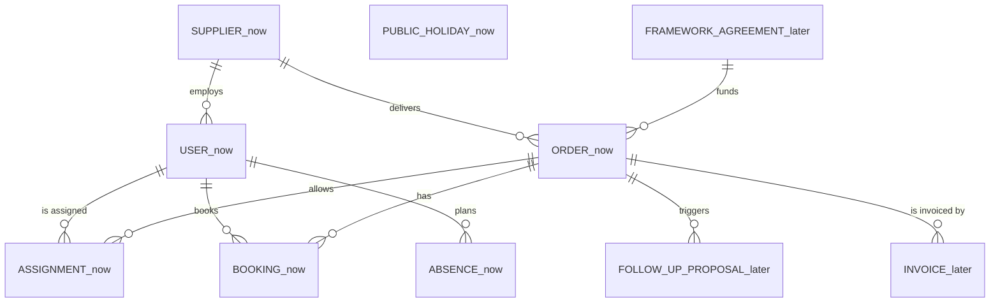

# Domain model

See [guide 2.3](guide.md#23-model-the-domain).

## Glossary

| Term | Meaning |
|---|---|
| Order (Bestellung) | A purchase order with number, period, budget in person-days and a supplier; every booking belongs to exactly one order |
| Person-day (PD) | One person working one day; in Pegal **1 PD = 8 hours** |
| Budget | Ordered person-days of an order |
| Used budget | Sum of the hours of all non-rejected bookings on the order, divided by 8 |
| Remaining budget | Budget minus used budget |
| Booking | One consultant, one date, hours (0.25 steps), one order, a short description and a status |
| Consultant | A person of the supplier who works on assigned orders |
| Assignment | The link that allows a consultant to book on an order |
| Absence | Planned vacation of a consultant; used only for the forecast |
| Public holiday | A day without work; nationwide holidays only |
| Burn rate | Average PD used per calendar week over the last 4 weeks |
| Exhaustion date | Date when the remaining budget reaches 0 at the current burn rate, adjusted for absences and holidays |
| Reorder lead time | Weeks purchasing needs to place a follow-up order (default 4, set per order) |
| Latest reorder date | Exhaustion date minus the reorder lead time |
| Traffic light | Green: budget lasts until the order end. Amber: budget ends before the order end, reorder date still ahead. Red: reorder date passed, or less than 10 % budget left |
| Proof of work (Leistungsnachweis) | Monthly list of hours per order, approved before invoicing |

## Entity relationship diagram

Entities we **build now** are marked `(now)`, entities of the **next expansion stage** `(later)`.

Planned tables (MySQL):

- `suppliers(id, name)`
- `users(id, name, email, password, role, supplier_id null)` where role is `consultant`, `project_lead`, `purchasing` or `finance`
- `orders(id, number, title, supplier_id, cost_center, project_element, budget_pd, starts_on, ends_on, reorder_lead_weeks)`
- `assignments(id, order_id, user_id)` unique on order and user
- `bookings(id, order_id, user_id, worked_on, hours, description, status)` with status `submitted`, `approved` or `rejected`
- `absences(id, user_id, starts_on, ends_on)`
- `public_holidays(id, holiday_on, name)`

## Notes

- **Remaining budget** = `budget_pd - sum(hours of bookings with status != rejected) / 8`.
- **Forecast** = remaining PD divided by the burn rate gives weeks left; working days that fall on absences or public holidays are skipped when counting forward from today. The result and its assumptions are shown, never hidden.
- **Hours per day, start and end times optional:** hours stay the default (fewer clicks, less personal data). If a consultant adds start and end, the overlap check and the 11-hour rest rule run too, see [ADR 0008](adr/0008-optional-start-and-end-times.md). Times are shown to the consultant only.
- Layering in code: `app/Http` (API/web objects), `app/Domain` (rules, forecast), `app/Models` (persistence entities).
